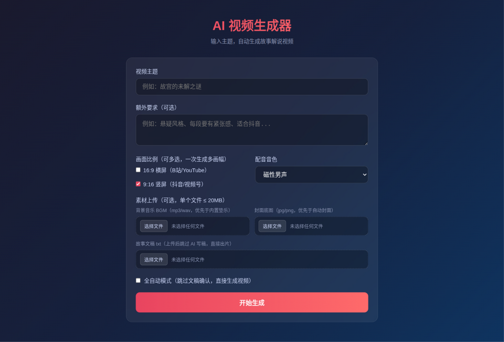
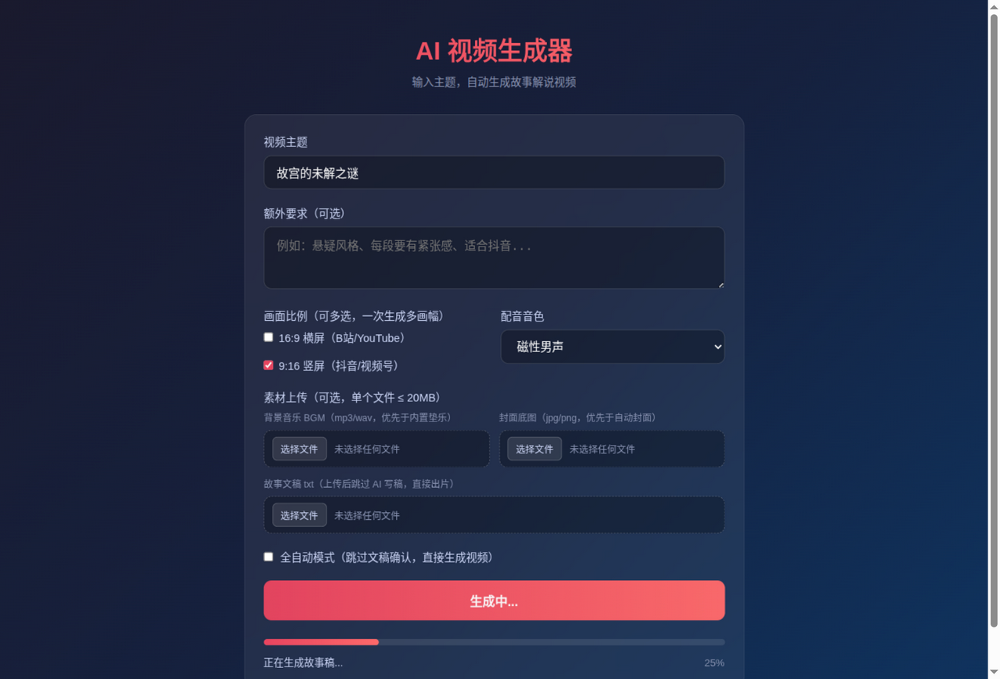
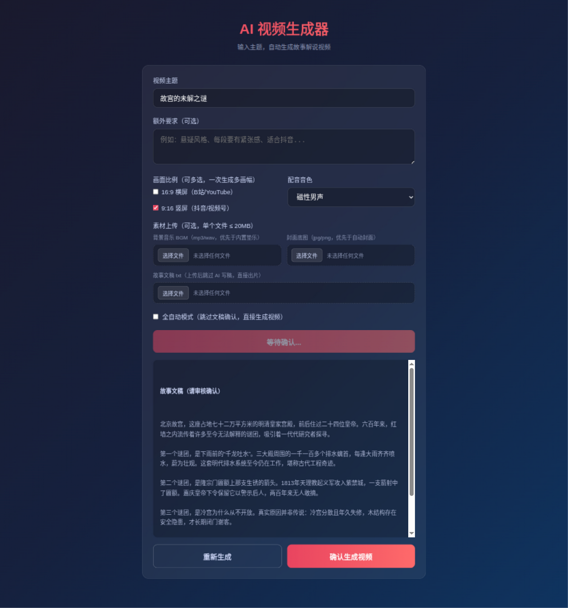
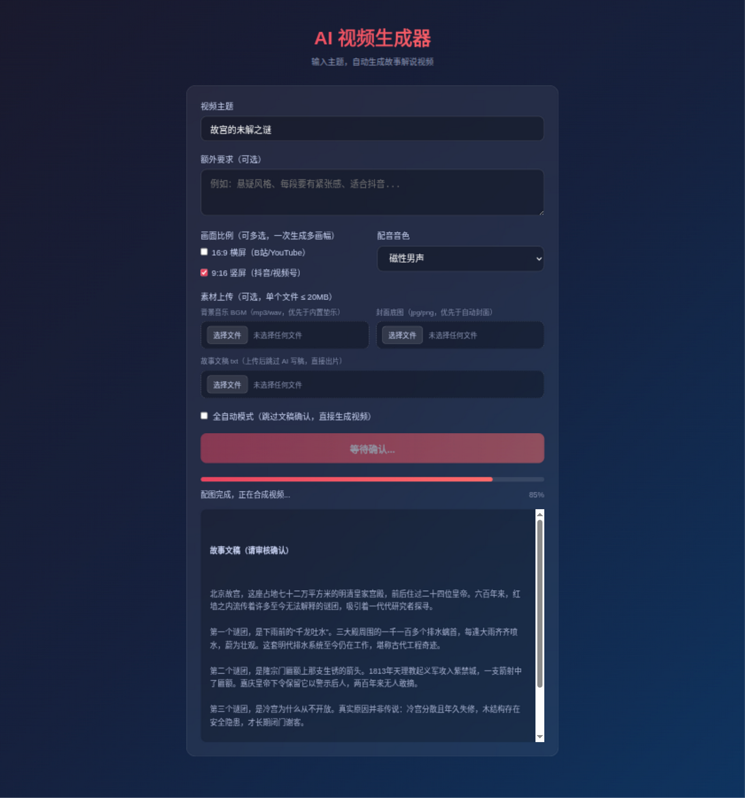
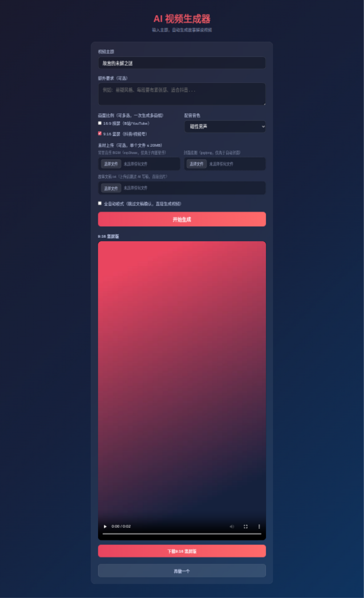

# StoryVid — AI Story Video

输入一个主题，自动完成：**搜索资料 → 内容审核 → AI 写稿 → 语音合成 → AI 配图 → 字幕生成 → 视频合成**，输出可直接发布的短视频。

支持两种工作模式：
- **交互模式（默认）**：写稿后人工审核，确认才继续生成视频
- **全自动模式**：输入主题直接出片，无需中途确认

> 2026-10 翻新：升级 MoviePy 2.x（兼容 Python 3.12–3.14）、修复 Web 界面画幅/音色不生效的问题、
> 字幕改为按句切分（不再出现整面字墙）、中文字体自动探测、配置预检、新增离线测试套件。

## 效果预览

```
主题: 房产周期的奥秘
故事稿 → 磁性男声配音 → AI生成配图 → 逐句字幕 → 竖屏MP4
输出: output/2025-05-01_房产周期的奥秘/房产周期的奥秘.mp4
```

Web 界面运行效果（以下截图来自离线演示任务：界面与任务流为真实页面，故事稿与成片为 mock 内容，截图过程见 `overnight_reports/B4_shots.md`）：



*首页：输入主题 / 画幅多选 / 音色 / 素材上传*



*生成过程：实时进度条与阶段消息（搜索 → 审核 → 写稿 → 语音 → 配图 → 合成）*



*交互模式：AI 写稿完成后先人工审核，可重新生成或确认*



*阶段二：配音配图完成后合成视频*



*结果页：成片在线预览 + 一键下载（多画幅时按画幅分别列出）*

## 快速开始

### 1. 安装依赖

```bash
# Python 3.10+（3.14 已验证）
python3 -m venv .venv
.venv/bin/pip install -r requirements.txt

# 系统依赖（音频处理）
# macOS
brew install ffmpeg

# Ubuntu/Debian
sudo apt-get install ffmpeg
```

#### 新机器安装（python3-venv 缺失时的引导）

Debian/Ubuntu 的系统 Python 有时不带 `venv`（报 `ensurepip is not available`，
提示先 `apt install python3-venv`）。没有 sudo 权限时，可用下面的**实测路径**绕过：

```bash
# 1) 先建一个不带 pip 的 venv（--without-pip 不需要 ensurepip，因此不依赖 python3-venv 包）
python3 -m venv --without-pip .venv

# 2) 用 get-pip.py 把 pip 装进 venv
curl -sS https://bootstrap.pypa.io/get-pip.py -o get-pip.py
.venv/bin/python get-pip.py

# 3) 正常装依赖
.venv/bin/pip install -r requirements.txt
```

> 以上 `--without-pip` + `get-pip.py` 路径在 python3-venv 缺失的机器上实测可行；
> 有 sudo 的话直接 `sudo apt-get install python3-venv` 后走标准 `python3 -m venv .venv` 即可。

#### pipx 安装（全局 `storyvid` 命令，不污染系统 Python）

项目已按标准 Python 包打包（`pyproject.toml`，控制台入口 `storyvid` = `main:main`，
依赖与 `requirements.txt` 同源）。用 [pipx](https://pipx.pypa.io/) 可以把它装成
隔离的全局命令，适合只想要命令行、不想维护仓库虚拟环境的用户：

```bash
# 1) 安装 pipx（一次性）
pip install pipx          # 或 brew install pipx / sudo apt install pipx
pipx ensurepath           # 把 ~/.local/bin 加进 PATH，重开终端生效

# 2) 从项目根目录安装（本地路径安装；项目暂未发布 PyPI）
cd storyvid
pipx install .

# 3) 之后在任意目录都能直接用（依赖装在 pipx 的独立虚拟环境里）
storyvid --help
storyvid --demo                       # 零 Key 离线体验
storyvid "故宫的未解之谜" --auto        # 与 python main.py 等价（同一入口）
```

注意事项：

- `storyvid` 命令与 `python main.py` 是同一个入口（`main.main()`），参数完全一致。
- **`.env` 放在运行命令时所在的目录**：pipx 安装后代码在虚拟环境里，读不到仓库根
  的 `.env`；源码方式运行则两处都兼容。
- **建议设置 `STORYVID_HOME`**：pipx 安装后输出/临时目录默认在 pipx 虚拟环境内部，
  `pipx upgrade`/重装会清掉历史视频。设一次即可把 `output/`、`temp/` 指到稳定位置：

  ```bash
  echo 'export STORYVID_HOME="$HOME/storyvid-data"' >> ~/.bashrc
  ```

- Web 界面目前仍需从仓库源码启动（`python web/app.py`）；pipx 装的包里虽然带了
  模板，但没有暴露 Web 入口命令。
- 升级：改动源码后 `pipx install . --force` 重装；卸载：`pipx uninstall storyvid`。

#### Python 3.14 兼容说明

- 本项目已在 **Python 3.14.4**（venv）+ moviepy 2.x 下实测通过离线测试套件。
- 关键约束：MoviePy 必须 **2.x**（`moviepy==1.0.3` 已不支持新版本 Python 的 API，
  requirements.txt 已锁定 `moviepy>=2.0.0`）；Pillow 需 `>=11.0.0`。
- 若在新版本 Python 上安装报 wheel 错误，先 `pip install --upgrade pip setuptools wheel`
  再重试；项目不依赖任何需要本地编译的包。

### 2. 零 Key 演示模式（不用配任何 Key 先看效果）

还没配 Key？先跑一条命令，**全程离线**（不调搜索/审核/LLM/TTS/配图任何 API，
不需要任何网络）看到成品效果：内置示例文稿 + 每段 3 秒静音配音 + PIL 渐变大字占位图，
完整走 分段→配音→配图→字幕→合成→封面：

```bash
python main.py --demo            # 环境变量 DEMO=1 同效
python main.py --demo --script-file 我的文稿.txt   # 用自己的文稿离线试跑
```

演示模式默认按预览分辨率（960×540 / 540×960）快速渲染（设 `PREVIEW=0` 用全分辨率），
产物与正式出片同构：`output/日期_主题/` 下有 mp4、cover.jpg、subtitles.srt、story.txt。
觉得效果不错，再回到下面第 3 步配 Key 出正片。

### 3. 配置 API Keys

```bash
cp .env.example .env
# 编辑 .env 填入你的 API Keys
```

**必填**：

| 服务 | 用途 | 获取地址 |
|------|------|----------|
| DeepSeek / 任意 OpenAI 兼容 API | 写故事稿 | [platform.deepseek.com](https://platform.deepseek.com) |
| StepFun / MiniMax / 火山引擎（豆包） | TTS 语音合成 | [platform.stepfun.com](https://platform.stepfun.com) / [platform.minimaxi.com](https://platform.minimaxi.com) / [console.volcengine.com/speech](https://console.volcengine.com/speech/app) |
| **Edge TTS（免费，无需 Key）** | TTS 语音合成（自带词级时间戳） | 无需申请，`TTS_PROVIDER=edge` 联网即用 |

**可选**（配图不配也能跑，会退回备用随机图）：

| 服务 | 用途 | 获取地址 |
|------|------|----------|
| MiniMax | AI 生成配图 | 同上 |
| Unsplash | 免费图库搜图 | [unsplash.com/developers](https://unsplash.com/developers) |
| 本地目录 | 用自己的图片素材 | 设置 `IMAGE_SOURCE=local` |

启动时会做配置预检，缺什么会明确告诉你。

#### 火山引擎（豆包）TTS

`TTS_PROVIDER=volc` 时走火山引擎「HTTP 非流式合成接口」，需在控制台
[语音技术-应用管理](https://console.volcengine.com/speech/app) 创建应用并开通
语音合成服务，然后在 `.env` 里配置：

```bash
TTS_PROVIDER=volc
VOLC_TTS_APPID=你的应用AppID
VOLC_TTS_TOKEN=你的访问令牌Access Token
VOLC_TTS_CLUSTER=volcano_tts        # 集群，需与开通的服务一致
VOLC_TTS_VOICE_TYPE=BV001_streaming # 音色，以控制台/官方音色列表为准
```

> ⚠️ **需真 key 实测**：本接入按官方公开文档结构实现（payload 为
> `app`/`user`/`audio`/`request` 四块，鉴权 `Authorization: Bearer;<token>`
> 分号分隔，响应音频 base64 解码），但**尚未用真实 key 验证过**；
> cluster 与音色请对照你开通的服务填写。参考文档：
> [HTTP 非流式合成接口](https://www.volcengine.com/docs/6561/79820)。

### 4. 启动

**Web 界面（推荐）**：
```bash
python web/app.py
# 打开 http://127.0.0.1:5000
# 勾选「全自动模式」= 一步出片，不勾选 = 先审核文稿再生成
# 画幅比例和音色按任务生效，多任务并发互不干扰
```

**命令行**：
```bash
# 交互模式：写稿后手动确认（会主动问是否有本地素材目录）
python main.py "故宫的未解之谜"

# 全自动模式：跳过确认
python main.py "故宫的未解之谜" --auto

# 竖屏 + 额外要求
python main.py "5G如何改变生活" --extra "科普风格，多点数据" --auto

# 本地素材优先：自己的照片/视频（如小区实拍）自动配到各段，
# 不够的段再走网上配图；视频自动截取到配音时长并静音
python main.py "阳光花园小区的新生活" --media-dir ~/Pictures/小区素材 --auto
```

## 工作流程

```
[搜索] → [安全审核] → [AI生成故事稿]
                           ↓
              交互模式：人工确认后继续
              全自动模式：直接继续
                           ↓
[分段] → [TTS语音合成] → [AI配图] → [逐句字幕] → [MoviePy合成视频]
```

健壮性设计：
- **搜索失败**不阻塞流程，直接走 LLM 常识生成
- **单段 TTS / 配图失败**只影响那一段（该段静音或用黑底帧），不中断整个任务
- **字幕按句切分**：每句话独立成块，按字符数比例分配时长；SRT 也是同样粒度
- **段间交叉淡化**（默认 0.6s，`CROSSFADE_SECONDS` 可调/设 0 关闭）：转场平滑、
  成片更紧凑；重叠区字幕已做窗口化（前段字幕提前收起），不会出现两层字幕叠画

每个任务在 `output/` 下生成独立目录，方便管理或删除：
```
output/2025-05-01_房产周期的奥秘/
├── story.txt          # 故事文稿
├── segment_000.mp3    # 每段语音
├── image_000.jpg      # 每段配图
├── frame_000_00.jpg   # 每句字幕帧
├── subtitles.srt      # 字幕文件（逐句粒度）
└── 房产周期的奥秘.mp4  # 最终视频
```

## 画面比例

- **9:16 竖屏**（1080×1920）— 抖音 / 视频号 / 小红书
- **16:9 横屏**（1920×1080）— B站 / YouTube

## 本地素材优先（自己的照片/视频）

做「小区宣传片」「楼盘介绍」这类视频时，自己的实拍素材永远比网上搜的贴题。
把照片/视频放进一个文件夹，生成时优先使用，不够的段再自动走网上配图：

```bash
# CLI：--media-dir 指定目录（交互模式也会主动询问）
python main.py "阳光花园小区的新生活" --media-dir ~/Pictures/小区素材 --auto
```

Web 界面在表单里填「本地素材目录」即可（本机路径）；也可以在 `.env` 里设
`LOCAL_MEDIA_DIR` 作为全局默认。分配规则：

- **照片**（jpg/jpeg/png/webp）自动配到各段；文件名/文件夹名命中该段配图
  关键词的优先配对，其余按文件夹里的顺序依次填充。照片多余时自动落成
  各段的「候选图」，在 Web 界面的候选列表里可以一键换上主图位。
- **视频**（mp4/mov/webm/mkv/avi）画面自动截取到该段配音的时长（短了自动
  循环铺满）、等比适配画幅、原声静音（旁白为主），多条视频在整条片里均匀
  分布；视频段同时也配一张照片兜底（视频损坏时顶上）+ 用作封面素材。
- 单文件上限 200MB；损坏的图/视频自动跳过或回退，不中断出片。
- 未覆盖到的段照旧走云端配图（MiniMax 生图 / Unsplash 搜图 → 兜底随机图）。

## 背景音乐（可选）

在 `.env` 里设置 `BGM_VOLUME` 即可为成片铺满一层柔和的氛围垫乐
（用 imageio-ffmpeg 自带的 ffmpeg 离线合成，不需要任何 API Key）：

```bash
BGM_VOLUME=0.2    # 0 = 关闭（默认）；推荐 0.15~0.35，垫乐音量低，配音始终在前
BGM_TEMP=warm     # 风格: warm 暖夜 / cool 清凉 / deep 低沉
```

垫乐 = 低通噪声层 + 三层低频正弦（协和音程）+ 慢呼吸起伏 + 低通滤波，
混音时自动首尾淡入淡出；合成或混音失败会自动跳过 BGM 继续出片。

### 自备曲库（BGM_DIR）

想用自己的音乐而不是合成垫乐时，把 `BGM_DIR` 指向本地曲目目录（递归扫描
其中的 `.mp3` / `.wav`，支持子文件夹）：

```bash
BGM_DIR=./my_music
```

- 有可用曲库时**优先从曲库选曲**，无曲库（未配置 / 目录不存在 / 没有音频
  文件）才回退合成垫乐；web 上传的单曲 BGM 仍是最高优先。
- 随机选曲且**当日不重复**：同一项目当天固定一首（多画幅批量渲染、换图/
  改词重渲、断点续跑时配乐保持一致，不会同一支视频换歌）；跨天重选会避开
  历史已用曲目，直到整库轮完一圈再重新开始。选曲记录存在项目目录的
  `_bgm_used.json`，删掉它即可强制重新选曲。
- 音量跟随 `BGM_VOLUME`；`BGM_VOLUME=0`（默认）时曲库按 0.25 音量自动开启
  ——配置了曲库即代表想用（与 Web 上传 BGM 同语义）。
- 曲库曲目同样自动首尾淡入淡出、比成片长自动截断、比成片短自动循环铺满；
  单个坏文件自动回退合成垫乐，不中断出片。

## 测试

```bash
pip install -r requirements-dev.txt
pytest
```

测试全部离线运行，不需要任何 API Key：覆盖文稿切分、字幕时间轴、视频合成
（真实写出一个小 MP4）、背景音乐合成与混音、TTS 时长探测、配置校验和 Web 接口。

## 项目结构

```
storyvid/
├── main.py              # CLI 入口
├── web/app.py           # Web 入口
├── story.py             # 故事生成 + 自我校验 + 多种风格
├── research.py          # DuckDuckGo 搜索 + 内容安全审核
├── llm.py               # LLM 客户端（懒加载）+ 宽松 JSON 解析
├── tts.py               # 语音合成（StepFun / MiniMax / 火山引擎 volc）
├── images.py            # 配图获取（MiniMax AI / Unsplash / 本地 / 备用图）
├── subtitles.py         # 字幕生成 + 逐句切分与时间轴分配
├── video.py             # 视频合成（MoviePy 2.x + Pillow）
├── config.py            # 全局配置 + 启动预检
├── pyproject.toml       # 打包配置（name=storyvid / 入口 storyvid=main:main）
├── tests/               # 离线 pytest 套件
├── .env.example         # 环境变量模板
├── requirements.txt
└── output/              # 输出目录
```

## 技术栈

- **LLM**: DeepSeek / 任意 OpenAI 兼容 API
- **TTS**: StepFun (step-tts-2) / MiniMax (speech-01-hd) / 火山引擎豆包（需真 key 实测）
- **配图**: MiniMax Image API / Unsplash / 本地图片 / Picsum 备用
- **视频合成**: MoviePy 2.x + Pillow（兼容 Python 3.14）
- **搜索**: DuckDuckGo (ddgs)
- **Web**: Flask + 原生 JS

## License

MIT
